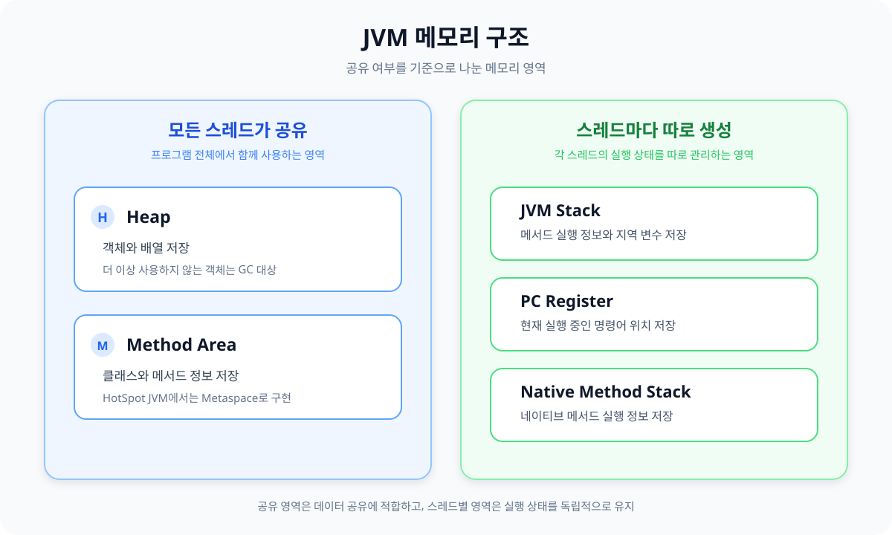

# JVM 메모리 구조

## JVM 메모리 구조란?

JVM은 자바 프로그램을 실행하면서 필요한 데이터를 메모리에 저장한다. 이때 데이터의 성격과 사용 범위에 따라 메모리를 여러 영역으로 나눠서 관리한다.

JVM의 메모리 영역은 크게 다음 5가지로 구분한다.

- Heap
- Method Area
- JVM Stack
- PC Register
- Native Method Stack

Heap과 Method Area는 모든 스레드가 함께 사용한다. 반면 JVM Stack, PC Register, Native Method Stack은 각 스레드의 실행 상태를 관리하기 때문에 스레드마다 따로 생성된다.

- 스레드: 하나의 프로그램 안에서 독립적으로 작업을 실행하는 단위
- 공유 영역: 여러 스레드가 함께 사용하는 메모리
- 스레드별 영역: 각 스레드가 자신의 실행 정보를 따로 저장하는 메모리

## 전체 구조



| 구분 | 메모리 영역 | 주요 역할 |
| --- | --- | --- |
| 모든 스레드가 공유 | Heap | 객체와 배열 저장 |
| 모든 스레드가 공유 | Method Area | 클래스와 메서드 정보 저장 |
| 스레드마다 생성 | JVM Stack | 메서드 실행 정보와 지역 변수 저장 |
| 스레드마다 생성 | PC Register | 현재 실행 중인 명령어 위치 저장 |
| 스레드마다 생성 | Native Method Stack | 네이티브 메서드 실행 정보 저장 |

## 영역별로 정리

### Heap

Heap은 `new`로 생성한 객체와 배열이 저장되는 영역이다.

```java
Member member = new Member("홍길동");
```

위 코드에서 실제 `Member` 객체는 Heap에 저장된다. 지역 변수 `member`에는 객체 자체가 아니라 Heap에 있는 객체를 가리키는 참조값이 저장된다.

- 참조값: 실제 객체를 찾아가기 위해 사용하는 값
- GC(Garbage Collection): 더 이상 사용하지 않는 객체를 찾아 정리하는 작업
- OOM(Out Of Memory): JVM이 필요한 메모리를 더 이상 확보하지 못한 상태

Heap은 모든 스레드가 공유한다. 따라서 여러 스레드가 같은 객체의 값을 동시에 변경하면 의도하지 않은 결과가 발생할 수 있다.

#### Heap의 세대 구분

Heap은 객체가 살아남은 기간을 기준으로 Young Generation과 Old Generation으로 나눠서 관리할 수 있다.

- Young Generation: 새로 생성된 객체가 주로 저장되는 영역
- Old Generation: 여러 번의 GC 이후에도 살아남은 객체가 주로 저장되는 영역

Young Generation은 다시 Eden과 Survivor 영역으로 나뉜다.

- Eden: 새 객체가 처음 생성되는 영역
- Survivor: GC 이후에도 살아남은 객체가 이동하는 영역

Eden에서 생성된 객체가 GC 이후에도 계속 사용되면 Survivor를 거쳐 Old Generation으로 이동한다. 다만 세부적인 Heap 구조와 객체 이동 방식은 사용하는 GC에 따라 달라질 수 있다.

### Method Area

Method Area는 JVM이 읽어 들인 클래스의 정보를 저장하는 영역이다. Heap이 실제 객체를 저장한다면 Method Area는 객체를 만들고 메서드를 실행하는 데 필요한 클래스 수준의 정보를 저장한다.

주로 다음과 같은 정보가 저장된다.

- 클래스 이름과 부모 클래스 정보
- 필드와 메서드 정보
- 메서드의 바이트코드
- Runtime Constant Pool

용어 정리

- 바이트코드: 자바 코드를 JVM이 실행할 수 있는 형태로 변환한 코드
- Runtime Constant Pool: 클래스에서 사용하는 상수와 클래스, 필드, 메서드의 참조 정보를 보관하는 공간
- 메타데이터: 클래스의 구조와 특징을 설명하는 정보

여러 스레드가 같은 클래스 정보를 사용하므로 Method Area는 모든 스레드가 공유한다.

#### Method Area와 Metaspace

Method Area와 Metaspace는 비슷한 의미로 사용되지만 정확히는 구분되는 개념이다.

- Method Area: JVM 명세에서 정의한 논리적인 메모리 영역
- Metaspace: HotSpot JVM에서 클래스 메타데이터를 저장하기 위해 사용하는 메모리 영역
- HotSpot JVM: 일반적으로 많이 사용되는 JVM 구현체
- Native Memory: JVM Heap이 아닌 운영체제에서 직접 할당받는 메모리

Metaspace는 Heap이 아니라 Native Memory를 사용한다. 이 공간이 부족하면 `OutOfMemoryError: Metaspace`가 발생한다.

### JVM Stack

JVM Stack은 스레드마다 하나씩 생성된다. 메서드가 호출되면 해당 메서드를 실행하기 위한 Stack Frame이 쌓이고, 메서드가 종료되면 제거된다.

- Stack Frame: 메서드 하나를 실행하기 위해 필요한 작업 공간
- 지역 변수: 메서드 내부에서 선언한 변수
- 매개변수: 메서드를 호출할 때 전달하는 값

Stack Frame에는 주로 다음 정보가 저장된다.

- 메서드의 매개변수
- 메서드 내부의 지역 변수
- 계산 과정에서 사용하는 중간 값
- 메서드 실행이 끝난 뒤 돌아갈 위치

```java
public static void main(String[] args) {
    int age = 20;
    Member member = new Member("홍길동");
    member.printName();
}
```

위 코드가 실행될 때의 흐름은 다음과 같다.

1. `main()`이 호출되면서 Stack Frame이 생성된다.
2. 지역 변수 `age`와 `member`가 `main()`의 Stack Frame에 저장된다.
3. 실제 `Member` 객체는 Heap에 저장된다.
4. `printName()`을 호출하면 새로운 Stack Frame이 생성된다.
5. `printName()`이 끝나면 해당 Stack Frame이 제거된다.
6. `main()`이 끝나면 `main()`의 Stack Frame도 제거된다.

메서드 호출이 지나치게 많이 쌓여 Stack 공간을 초과하면 `StackOverflowError`가 발생한다. 대표적인 원인은 종료 조건이 없거나 잘못 작성된 재귀 호출이다.

- 재귀 호출: 메서드가 자기 자신을 다시 호출하는 방식

```java
void recursive() {
    recursive();
}
```

### PC Register

PC Register는 현재 실행 중인 JVM 명령어의 위치를 저장한다.

CPU는 여러 스레드를 번갈아 실행한다. 따라서 각 스레드는 자신의 실행 순서가 다시 돌아왔을 때 어디서부터 이어서 실행해야 하는지 기억할 필요가 있다.

스레드마다 실행 위치가 다르기 때문에 PC Register도 스레드마다 하나씩 생성된다.

- PC: Program Counter의 약자
- JVM 명령어: JVM이 바이트코드를 실행할 때 처리하는 각각의 명령

### Native Method Stack

Native Method Stack은 자바가 아닌 다른 언어로 작성된 메서드를 실행할 때 사용한다. 주로 자바에서 C나 C++ 코드를 호출하는 경우가 해당된다.

- Native Method: 자바가 아닌 다른 언어로 작성된 메서드
- JNI(Java Native Interface): 자바에서 C나 C++ 코드를 호출할 수 있게 해주는 기능

일반 자바 메서드는 JVM Stack을 사용하고, 네이티브 메서드는 Native Method Stack을 사용한다.

## 추가 내용

**Q. 스택과 힙의 차이는?**

- **스택:** 스레드마다 따로 생성되며 메서드가 끝나면 해당 Stack Frame도 바로 제거됨. 지역 변수와 객체를 가리키는 참조값 등이 저장됨
- **힙:** 모든 스레드가 공유하며 객체와 배열이 저장됨. 더 이상 참조되지 않는 객체는 GC가 정리함
- **멀티스레드 관점:** 지역 변수는 스레드별 Stack에 따로 저장되지만, Heap의 객체는 여러 스레드가 함께 접근할 수 있으므로 동기화가 필요할 수 있음

**Q. `Person p = new Person();`을 실행하면 메모리에서는 어떤 일이 일어날까?**

- `Person` 클래스가 아직 로딩되지 않았다면 클래스 정보가 Method Area에 올라감
- HotSpot JVM에서는 클래스 메타데이터를 Metaspace에 저장함
- `new Person()`으로 생성한 객체는 일반적으로 Heap의 Eden 영역에 저장됨
- 지역 변수 `p`에는 객체를 가리키는 참조값이 저장됨
- `p`가 메서드 안의 지역 변수라면 해당 참조값은 현재 메서드의 Stack Frame에 저장됨

**Q. Method Area와 Metaspace는 같은 개념일까?**

- **Method Area:** JVM 명세에서 클래스 정보를 저장하도록 정의한 논리적인 영역
- **Metaspace:** HotSpot JVM에서 클래스 메타데이터를 저장하는 실제 영역
- 비슷한 역할을 하지만 Method Area는 개념이고 Metaspace는 이를 구현하는 방식 중 하나임
- Metaspace는 Heap이 아니라 Native Memory를 사용함

**Q. GC가 있는데도 `OutOfMemoryError`가 발생할 수 있을까?**

- GC는 더 이상 참조되지 않는 객체만 정리할 수 있음
- 사용하지 않는 객체라도 코드에서 계속 참조하고 있으면 GC의 정리 대상이 아님
- 이런 객체가 계속 쌓이거나 한 번에 너무 많은 객체를 생성하면 Heap 공간이 부족해질 수 있음
- GC가 있다는 것이 메모리를 무한히 사용할 수 있다는 의미는 아님

**Q. `StackOverflowError`와 `OutOfMemoryError`의 차이는?**

- **StackOverflowError:** 한 스레드의 Stack에 Stack Frame이 지나치게 많이 쌓였을 때 발생함
- **OutOfMemoryError:** JVM이 Heap이나 Metaspace 등에 필요한 메모리를 더 이상 확보하지 못했을 때 발생함
- 종료 조건이 없는 재귀 호출은 `StackOverflowError`의 대표적인 원인
- 객체를 과도하게 생성하거나 필요 없는 객체를 계속 참조하는 경우 `OutOfMemoryError`가 발생할 수 있음

**Q. String Pool은 왜 필요하고 어디에 있을까?**

- 같은 문자열 리터럴을 재사용해 불필요한 문자열 객체 생성을 줄이기 위한 공간
- String Pool은 Heap 안에 존재함
- `String first = "hello";`와 `String second = "hello";`는 같은 문자열 리터럴을 참조할 수 있음
- Runtime Constant Pool과 이름은 비슷하지만 서로 다른 개념임

**Q. 지역 변수는 항상 멀티스레드 환경에서 안전할까?**

- 기본 타입의 지역 변수는 각 스레드의 Stack에 따로 저장되므로 다른 스레드와 직접 공유되지 않음
- 객체를 가리키는 지역 변수의 참조값도 스레드별 Stack에 저장됨
- 다만 해당 참조값이 가리키는 Heap 객체를 여러 스레드가 함께 사용한다면 동시성 문제가 발생할 수 있음
- 지역 변수 자체와 지역 변수가 가리키는 객체를 구분해서 확인할 필요가 있음

**Q. 스레드마다 JVM Stack과 PC Register가 따로 필요한 이유는?**

- 스레드마다 호출 중인 메서드와 지역 변수의 값이 서로 다름
- JVM Stack을 분리하면 각 스레드의 메서드 실행 정보가 서로 섞이지 않음
- PC Register에는 스레드가 현재 실행 중인 명령어의 위치가 저장됨
- CPU가 스레드를 전환한 뒤에도 각 스레드가 이전 실행 위치부터 이어서 실행할 수 있음

## 핵심 정리

- JVM은 데이터를 성격과 사용 범위에 따라 여러 메모리 영역으로 나눠서 관리한다.
- Heap과 Method Area는 모든 스레드가 공유한다.
- JVM Stack, PC Register, Native Method Stack은 스레드마다 따로 생성된다.
- 객체와 배열은 Heap에 저장된다.
- 클래스와 메서드 정보는 Method Area에 저장된다.
- 메서드 실행 정보와 지역 변수는 JVM Stack에 저장된다.
- PC Register는 현재 실행 중인 명령어의 위치를 저장한다.
- Native Method Stack은 네이티브 메서드를 실행할 때 사용한다.
- Method Area는 JVM 명세상의 개념이고, Metaspace는 HotSpot JVM의 구현 방식이다.
- 더 이상 참조되지 않는 Heap 객체는 GC의 정리 대상이 된다.
- Stack 공간이 부족하면 `StackOverflowError`가 발생한다.
- Heap이나 Metaspace 공간이 부족하면 `OutOfMemoryError`가 발생한다.
